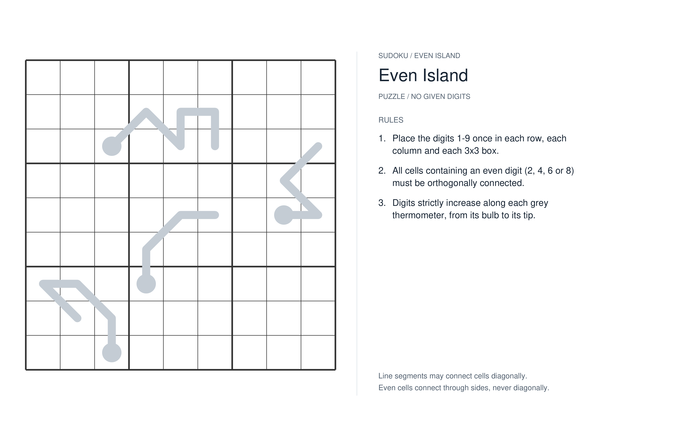

# Sudoku Island

Find the smallest number **k** for which a 9x9 grid contains a **single nonempty,
orthogonally connected island** with exactly k selected cells in **every row,
every column, and every 3x3 box**.

**The minimum is 4.** An exhaustive search rules out k = 1, 2, 3, then produces
an island of 36 cells for k = 4. **This island is unique up to rotations and
mirror reflections:** there are exactly **8 distinct oriented patterns**, all
images of the same shape. An exhaustive search outside these eight images
finds no other island. The shape and a valid Sudoku whose **even digits
(2, 4, 6, 8) are exactly the island** are displayed below.

This is a rewrite of the supplied `sudoku_island_project.zip`. The original
searched one hardcoded quota using cell assignments and a rollback data
structure. This version uses a smaller row-frontier search, searches the minimum
automatically, and distinguishes completed searches from interrupted ones.

## A zero-given puzzle

The next stage is now available: [**Even Island**](constructions/even_island_01/puzzle.png),
a Sudoku with **four thermometers, no given digits, and exactly one solution**.
All even digits must form a side-connected island, and digits strictly
increase along each thermometer from its bulb. The four paths use 19 distinct
cells, without overlaps or crossings.



The uniqueness check considers all eight island orientations and all digit
fillings. Removing the island rule, removing any thermometer, or trimming
either end of any thermometer gives multiple solutions. This establishes
local irreducibility; it does not prove a global minimum clue count.
Human difficulty and a satisfying manual solve path still need playtesting.

Three more proposals are now in the [landscape construction catalogue](constructions/README.md):

- [Two Anchors](constructions/even_island_02/puzzle.png): two essential parity
  marks and four short thermometers, using 20 marked cells. Two is the proven
  minimum number of parity marks needed to orient the island before other clues.
- [Whispered Island](constructions/even_island_03/puzzle.png): two German whisper
  lines and a two-cell thermometer, using 24 marked cells. The whispers leave
  exactly two complementary solutions; the thermometer selects one.
- [Two Even Anchors](constructions/even_island_04/puzzle.png): two even squares
  fix all parities, then four four-cell thermometers fix the digits. It uses
  18 marked cells. A checked certificate rules out three short thermometers
  for this particular filling, even with the entire parity mask supplied.
  The global three-thermometer goal remains open for other digit fillings.

All cards are standalone English landscape PNGs rendered from SVG: grid on
the left, title and rules on the right. Every statement uses "orthogonally
connected" for the even-cell rule. Each proposal has a separate solution card,
printable PDF, and exact removal audit. The original proposal was shortened
from 20 to 19 marked cells by removing an unnecessary interior thermometer cell.

The unrestricted connected-even rule admits **318,563,942,400** filled Sudokus.
Difference-only clues cannot remove the complementary solutions related by
`d -> 10-d`, which preserves parity and absolute differences. Thermometers
break this symmetry. See the [construction catalogue and tools](constructions/README.md),
[full freedom analysis](constructions/analysis.md), and
[recorded verification](constructions/even_island_01/verification.json).
The catalogue includes separate solution cards and SVG sources for every PNG.

A separate [rule-only solver benchmark](benchmarks/README.md) measures all four
statements with ordinary CSP backtracking, graph propagation and SAT with
connectivity cuts. These methods receive no island theorem, precomputed parity
mask or expected solution. The [results table](benchmarks/report.md) records
first-solution effort, uniqueness status, search counters and peak process
memory, with explicit timeouts rather than inferred difficulty ratings.

The [classic reference comparison](benchmarks/classics/README.md) benchmarks
AI Escargot, Golden Nugget, Platinum Blonde and Everest using only their numeric
givens and ordinary Sudoku rules. It includes the finished island SAT campaign
for an automatic-search comparison, with the different run protocols stated.

For unattended searches, `start_campaign.bat` launches both SAT connectivity
encodings on all four statements, with separate 30-minute first-solution and
uniqueness budgets. Open **`campaign_status.bat`** for live progress; closing
the viewer leaves the campaign running. See the [campaign instructions](benchmarks/README.md#offline-sat-campaign).

```sh
python island_puzzles.py analyze
python island_puzzles.py verify constructions/even_island_01/puzzle.json --audit
python -m constructions.build --check
python -m constructions.search --output output/candidate.json
python -m constructions.parity --json output/parity-analysis.json
```

These commands use only the Python standard library. To rebuild the SVG, PNG
and printable PDF cards, install the optional renderer and run:

```sh
python -m pip install -e ".[artwork]"
python -m constructions.build
```

The PNG and PDF cards are supplied ready to share; installing a renderer is
unnecessary for solving, searching or checking the committed cards.

## Run

Python **3.10 or newer**, with **no runtime dependencies**. From this directory:

```sh
python sudoku_island.py
```

This searches positive quotas in ascending order and stops at the first witness.
To also construct a real Sudoku **after** the abstract search:

```sh
python sudoku_island.py --minimum --check-uniqueness --sudoku --json results.json
```

The reference run took approximately 3 seconds to find the abstract minimum,
87 seconds to prove uniqueness, and less than a second for digit placement
on the development machine (Python 3.12).
Runtime depends on the machine. The actual result is saved in
[docs/results.json](docs/results.json).

Other examples:

```sh
python sudoku_island.py --k 3
python sudoku_island.py --k 4 --sudoku
python sudoku_island.py --k 4 --check-uniqueness
python sudoku_island.py --minimum --timeout 30 --max-states 100000
python sudoku_island.py --box-side 2
python -m unittest discover -s tests -v
```

`--box-side 2` uses a 4x4 grid with 2x2 boxes; its minimum is 3. Digit completion
is supported for the standard 9x9, k=4 problem only. Bounds apply separately
to each quota and to the uniqueness check; time is checked at search-state entry, rather
than enforced by an external process deadline. The optional digit search has
no time limit.

Installation is optional:

```sh
python -m pip install .
sudoku-island --minimum --sudoku
```

## What the answers mean

- **SAT:** a complete witness was found and independently validated.
- **UNSAT:** all possible continuations were exhausted or rejected by proven
  necessary conditions. No such island exists for this quota.
- **UNKNOWN:** a resource limit interrupted the search. This proves neither
  existence nor nonexistence. A minimum search stops immediately at this quota.

Exit status is 0 for a completed decision (SAT or UNSAT), and 2 for an incomplete
search or invalid command. `--json PATH` writes the statuses, statistics, row
masks, and optional Sudoku. A minimum is reported only when **every smaller
positive quota is UNSAT** and the current quota is SAT. A fixed-quota run does
not claim minimality.

An island must be nonempty: k=0 is UNSAT by definition. Diagonal contact does
not connect cells; board edges do not wrap. Every selected cell must belong to
the same component. The program does not optimize the size of one component
while allowing other selected cells to lie outside it.

## A concrete solution

`O` marks an island cell and `.` an unselected cell:

```text
+---+---+---+
|OOO|O..|...|
|O..|O..|.OO|
|...|OO.|.OO|
+---+---+---+
|...|.O.|OOO|
|O..|.OO|O..|
|OOO|..O|...|
+---+---+---+
|..O|OOO|...|
|.OO|..O|O..|
|.O.|...|OOO|
+---+---+---+
```

For this unique shape, the separate digit-placement stage quickly produces
the following Sudoku:

```text
+-------+-------+-------+
| 2 4 6 | 8 1 3 | 5 7 9 |
| 8 3 9 | 2 5 7 | 1 4 6 |
| 5 7 1 | 6 4 9 | 3 2 8 |
+-------+-------+-------+
| 3 9 5 | 7 2 1 | 8 6 4 |
| 4 1 7 | 9 6 8 | 2 3 5 |
| 6 2 8 | 5 3 4 | 7 9 1 |
+-------+-------+-------+
| 7 5 2 | 4 8 6 | 9 1 3 |
| 1 8 4 | 3 9 2 | 6 5 7 |
| 9 6 3 | 1 7 5 | 4 8 2 |
+-------+-------+-------+
```

Every row, column and box contains 1 through 9 exactly once. The even cells
coincide with the abstract island. Rotating or reflecting this Sudoku completes
each of the other seven orientations. Thus **every minimum island** has an
even-digit Sudoku completion. The program establishes this by uniqueness and
an explicit witness; it does not assume that arbitrary binary patterns admit
digits. The Sudoku's digits themselves are not claimed to be unique.

## Why the search is exhaustive

Each row is one of all `binomial(9, k)` possible k-cell masks. The search carries
column counts, counts for the current band of boxes, and component labels on
the last processed row. When a component loses all contact with this frontier,
it can never connect to a later row, so that branch is rejected. Quota bounds
reject rows that cannot possibly reach the required counts.

Failed states with identical counts and frontier partitions have identical
possible futures and can be reused. No arbitrary row, column or box
permutations are used as symmetries: those can change geometric adjacency.

For uniqueness, the solver excludes the reference island and its geometric
orbit, then exhaustively seeks another solution. It tracks which excluded
patterns still match the current row prefix **in its memoization key**;
otherwise two identical frontier states could have different allowed suffixes.
The completed outside-orbit search returns UNSAT, proving uniqueness. Its
493,104 expanded states and 434,528 failed-state cache hits are recorded in
the JSON report. A limited check returns UNKNOWN and never claims uniqueness.
On problems with several shapes, NON_UNIQUE includes a second validated
witness outside the reference orbit and does not claim to count all shapes.

For k = 1, 2, 3, **every branch is accounted for** by exploration, sound pruning,
or reuse of an already exhausted state. The k=4 run stops at its first witness;
it does not enumerate all solutions. State counts are not counts of all binary
boards and are not a percentage of the search space.

| k | Result | Expanded states | Failed-state cache hits |
|---|---|---:|---:|
| 1 | UNSAT | 10 | 0 |
| 2 | UNSAT | 84 | 0 |
| 3 | UNSAT | 1,016 | 3 |
| 4 | SAT | 19,894 | 8,761 |

The [LaTeX proof](docs/completeness.tex) and its
[compiled PDF](docs/completeness.pdf) prove the state invariant, pruning safety,
memoization equivalence, termination, completeness, and uniqueness check. The reported numerical
minimum is a **computer-assisted result**, based on that algorithm and the
recorded run, rather than a separate closed-form impossibility argument.
The JSON report is an audit record, not an independently checkable UNSAT proof
certificate. The implementation has not been verified by a proof assistant.

## Verification and layout

```sh
python -m unittest discover -s tests -v
```

The tests compare the independent witness checker against **all 65,536 binary
4x4 boards**, compare the frontier update with full graph traversal for all
4-column prefixes up to three rows, and test standard-grid results, digit
completion, all twelve small-board k=3 solutions via successive exclusions,
symmetry orbits, and interrupted searches. GitHub Actions
runs the tests on Python 3.10, 3.12 and 3.13 and exercises the installed command.
Rule-only benchmark tests check all 3^9 ternary states of a small connectivity
graph and run unique/multiple/unsatisfiable fixtures with theorem entry points
disabled. The Python 3.12 CI job also installs and tests the optional SAT engine.

- `sudoku_island.py`: exact abstract solver, independent witness checker, CLI.
- `sudoku_completion.py`: separate digit-placement search and Sudoku checker.
- `island_puzzles.py`: exact digit counts, parity/thermometer/whisper/renban verifier,
  landscape SVG renderer.
- `constructions/`: search/build tools, analysis and one folder per proposal,
  with standalone English PNG cards, SVG sources, solutions and verification.
- `benchmarks/`: rule-only CSP/SAT solvers, isolated-run harness and measured
  time, search-work and process-memory reports.
- `tests/`: independent small-board oracles and regression tests.
- `docs/`: completeness proof, compiled PDF and reference result.
- `pyproject.toml`: optional installation and command entry point.

The legacy input archive stays local and is ignored by Git. All implementation,
messages and documentation are in English.

To rebuild the proof, install a LaTeX distribution and run from the repository
root:

```sh
pdflatex -interaction=nonstopmode -halt-on-error -output-directory=docs docs/completeness.tex
```

The algorithm is exponential in the worst case; the generalized box size is
mainly useful for small independent checks. Resource exhaustion or a forcibly
terminated process never constitutes an UNSAT result.
