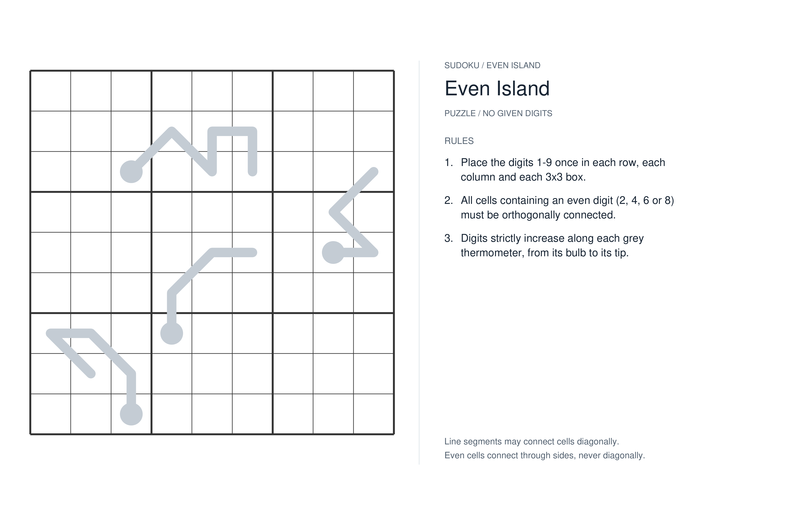

# Construction catalogue

This directory holds the construction tools, the proposed puzzles, their
solutions, and shareable English cards. Every proposal has its own stable
directory. Future proposals can be added without overwriting earlier designs.

## Published proposals

| Proposal | Clues | Puzzle | Solution (spoiler) |
|---|---|---|---|
| 01 - Even Island | Four thermometers, 19 marked cells | [PNG](even_island_01/puzzle.png), [SVG](even_island_01/puzzle.svg), [PDF](even_island_01/puzzle.pdf) | [PNG](even_island_01/solution.png), [SVG](even_island_01/solution.svg), [JSON](even_island_01/solution.json) |
| 02 - Two Anchors | Two parity marks, four short thermometers, 20 marked cells | [PNG](even_island_02/puzzle.png), [SVG](even_island_02/puzzle.svg), [PDF](even_island_02/puzzle.pdf) | [PNG](even_island_02/solution.png), [SVG](even_island_02/solution.svg), [JSON](even_island_02/solution.json) |
| 03 - Whispered Island | Two German whispers and one two-cell thermometer, 24 marked cells | [PNG](even_island_03/puzzle.png), [SVG](even_island_03/puzzle.svg), [PDF](even_island_03/puzzle.pdf) | [PNG](even_island_03/solution.png), [SVG](even_island_03/solution.svg), [JSON](even_island_03/solution.json) |



The PNG is a complete statement: it includes the Sudoku rules, thermometer
rules, the "orthogonally connected" even-island rule, and the distinction between
diagonal line segments and side adjacency. All three proposals have no given
digits. Proposal 02 deliberately includes two blue parity marks. Each solution
is on a separately labeled card.

Each PNG is **3840 x 2400 pixels**, rendered at 3x scale directly from its SVG.
The grid is on the left and the title and complete rules on the right.
The PNG embeds the SHA-256 digest of that SVG. The renderer checks uniqueness
before building either card. The solution card highlights even cells so that
the island can be inspected directly.

The [machine-readable puzzle](even_island_01/puzzle.json) and
[recorded verification](even_island_01/verification.json) accompany proposal 01.
Every published island rule, line, parity mark and removable endpoint is
essential under the recorded removal tests. All legal single-cell interior
thermometer shortcuts have also been tested and fail to preserve uniqueness.
This is local irreducibility, not a global
minimum clue count or a human difficulty rating. The [analysis](analysis.md)
explains the digit freedom, uniqueness checks, and construction method.

## What makes a useful elegant construction?

We compare several costs instead of treating every long line as one cheap
clue. A nine-cell thermometer can encode nine fixed digits, so minimizing
line count alone can make a puzzle less interesting.

| Proposal | Lines | Parity marks | Marked cells | Segments | Turns | Rule families beyond Sudoku and connectivity |
|---|---:|---:|---:|---:|---:|---|
| 01 | 4 | 0 | 19 | 15 | 11 | Thermometers |
| 02 | 4 | 2 | 20 | 14 | 9 | Parity, thermometers |
| 03 | 3 | 0 | 24 | 21 | 14 | Thermometers, German whispers |

These alternatives trade different costs. Proposal 01 uses one familiar clue
family and the least marked area. Proposal 02 makes the geometry-vs-digits
separation explicit with short thermometers. Proposal 03 uses fewer lines and
has a clear final symmetry-breaking clue, at the cost of longer paths and
another rule family. Counts of turns are descriptive, not a human difficulty
score. All artwork avoids line crossings, shared line cells, and parity marks
on the lines.

Our acceptance criteria are: exact uniqueness over all eight island masks;
an essential connectivity rule; essential individual clues; irreducibility
under line removal, endpoint trimming, and legal thermometer shortcuts;
readable geometry; and no printed digit values. A satisfying manual solve
path still requires human testing. In particular, exact uniqueness is not
evidence that discovering the island theorem is easy for a solver.

### Two Anchors: a genuinely global parity variant

The blue square at r1c1 is even and the blue circle at r8c9 is odd. Before
adding lines, these two marks select the reference orientation from all eight.
Neither singleton can do so. Exhaustive checks of all 81 singleton positions
and all 3,240 pairs find **378 orienting pairs** for the reference mask.
By square symmetry the singleton impossibility covers all orientations.
Thus **two is the exact minimum for orientation alone**. See
[parity-analysis.json](parity-analysis.json) and `parity.py`.

The two marks alone still leave 39,820,492,800 digit fillings; they do not
specify any numeric value. Their role survives in the completed puzzle:

| Constraints on proposal 02 | Exact filled-grid count |
|---|---:|
| Four thermometers, no parity marks | 743 |
| Thermometers and the even square only | 397 |
| Thermometers and the odd circle only | 246 |
| Thermometers and both marks | 1 |

Every number in this table comes from finished enumeration across all eight
masks. The marks lie off the thermometers, and removing either mark allows a
different island orientation. This separates a global geometry clue from a
local given digit. The four thermometers then determine the digit filling.
Two is not claimed to be a minimum number of total clues.

### Whispered Island: one inequality breaks the complement

The two green lines leave **exactly two** filled grids, related by `d -> 10-d`.
The two-cell thermometer eliminates one. Zero directional clues cannot
distinguish that pair; one suffices for these fixed whispers. This is a
conditional minimum, not a proof that all possible two-line puzzles fail.
German whisper neighbors differ by at least 5; no negative constraint applies
off the lines. No givens or parity marks appear in this proposal.

## Check and rebuild the cards

Run all commands from the repository root. Checking uses only the standard
library and leaves the artwork untouched:

```sh
python -m constructions.build --check
python island_puzzles.py verify constructions/even_island_01/puzzle.json --audit
```

The check reruns the exact verifier, compares the saved solution with its
unique completion, checks both SVG sources, and validates each PNG's size,
chunk integrity and source digest, and the verification record's canonical
JSON source digest. It does not claim pixel-for-pixel rendering
identity across different renderer versions.

To regenerate all cards and the printable puzzle PDF:

```sh
python -m pip install -e ".[artwork]"
python -m constructions.build
```

Only artwork generation needs the optional PyMuPDF dependency. Solving and
construction search remain standard-library-only. To rebuild one proposal:

```sh
python -m constructions.build constructions/even_island_01
```

The blank card and solution card are generated from the same puzzle JSON.
The grid in `solution.json` is recomputed and independently validated. Editing
an image by hand is unnecessary; edit the JSON or renderer and rebuild. The
build also refreshes the compact verification audit and design metrics.

## Search for another construction

`search.py` preserves the counterexample-guided construction method. It
generates increasing, noncrossing king-adjacent paths on a target Sudoku,
solves a bounded hitting-set problem against competing grids, checks all
eight island orientations, and trims redundant clues and endpoints.
It accepts a result only if the island rule is also essential.

```sh
python -m constructions.search --output output/candidate.json
python -m constructions.search --max-lines 3 --timeout 120 --output output/three-line-candidate.json
python -m constructions.search --target constructions/even_island_01/solution.json --output output/another-candidate.json
python -m constructions.search --target constructions/even_island_02/solution.json --parity-from constructions/even_island_02/puzzle.json --min-length 3 --max-lines 4 --max-iterations 400 --output output/parity-candidate.json
python -m constructions.search --target constructions/even_island_03/solution.json --profile mixed --max-lines 3 --output output/whisper-candidate.json
python -m constructions.parity --json output/parity-analysis.json
```

The default target is the first digit completion of the reference island.
`--target` accepts another valid connected-even Sudoku in the same solution
JSON format. Path lengths, line count, iterations and time are configurable.
`--profile mixed` adds a bounded, reproducible sample of German whisper paths;
`--profile renban` offers an experimental renban/thermometer search. Renban
digits are consecutive and nonrepeating in any order. No renban proposal is
published here yet. `--seed` controls sampled paths. The mixed-profile time
budget applies after preparing the path pool.

The selection order is deterministic. Search outputs a new puzzle JSON only
on `FOUND` and refuses to overwrite existing output files.

`NO_COVER_IN_POOL` concerns only that target, finite candidate-path pool and
line budget. It does not rule out other targets, other line types, or all
three-line constructions. A time or iteration limit gives `UNKNOWN`. When
parity marks are supplied, redundant-mark designs are rejected; exhaustion
after those heuristic rejections is also UNKNOWN, not an impossibility
certificate. The verifier supports parity marks, thermometers, German whispers
and renban lines; proposed cards must spell out every applicable rule.

To publish a new candidate, create a new folder such as `even_island_02`, place
the accepted puzzle JSON there as `puzzle.json`, run the exact audit, and build
its cards. Add a row to this catalogue after inspecting both rendered PNGs.
The existing proposal remains unchanged by searches for future designs.

## Layout

```text
constructions/
  README.md                 Catalogue and reproduction instructions
  analysis.md               Mathematical freedom and design analysis
  search.py                 Bounded thermometer/whisper/renban construction search
  parity.py                 Exhaustive minimum-orientation-mark analysis
  parity-analysis.json      Recorded two-mark minimum and example
  build.py                  SVG, PNG, PDF and solution generation/checking
  even_island_01/
    puzzle.json             Complete machine-readable statement
    puzzle.svg              Vector source of the blank card
    puzzle.png              Standalone English puzzle card
    puzzle.pdf              Printable A4 puzzle
    solution.json           Verified unique digit grid
    solution.svg            Vector source of the solution card
    solution.png            English solution card with even-cell shading
    verification.json       Recorded counts, witnesses and removal audits
  even_island_02/            Same files for Two Anchors
  even_island_03/            Same files for Whispered Island
```
