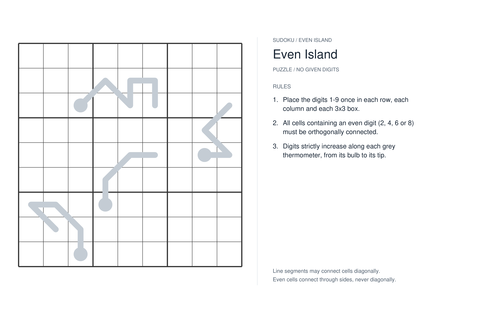

# From an island theorem to a playable Sudoku

The abstract theorem reduces the possible even-cell geometries to eight
orientations of one shape. It does **not** fix the digits. The next step is a
Sudoku with no given digits, the connected-even rule, and a few graphical clues.

## Exact degrees of freedom before adding clues

For one fixed orientation, even and odd digits can be assigned independently.
Every unit contains four even cells and five odd cells. Within each layer,
cells sharing a row, column or box must have different digits. Completing both
layers therefore supplies all nine distinct digits in every unit; there are
no further interactions between the layers until extra clues are imposed.

Fix the even digits in the first row to 2, 4, 6, 8 in left-to-right order, and
the odd digits there to 1, 3, 5, 7, 9. Exhaustive enumeration gives:

| Freedom | Exact count |
|---|---:|
| Even placements with first-row labels fixed | 704 |
| Odd placements with first-row labels fixed | 19,640 |
| Global permutations of the even labels | 4! = 24 |
| Global permutations of the odd labels | 5! = 120 |
| Fully labeled Sudokus per orientation | 39,820,492,800 |
| Geometric orientations | 8 |
| **All connected-even Sudokus before clues** | **318,563,942,400** |

This normalization is exact: every digit of a layer occurs once in its first
row, so there is exactly one relabeling taking that row to the prescribed
order. The permutation action is free. The two layer counts multiply, and
the eight parity masks are disjoint and equivalent under geometric symmetry.
Consequently the total is

```text
8 × (704 × 24) × (19,640 × 120) = 318,563,942,400.
```

This is approximately 2^38.21 possibilities. It is a search-space size, not
a lower bound on the number of lines: one geometric line can convey many
constraints, and its length and location also matter. The 704 and 19,640
counts show why the remaining freedom is much larger than simple digit
permutations.

## Why difference lines alone cannot give uniqueness

With no given digits, replace every digit d by 10-d. Each Sudoku unit remains a permutation of 1-9,
parity is preserved, and all absolute differences are unchanged. Every
connected-even Sudoku using only lower bounds on absolute differences
therefore has a distinct complementary solution.

In particular, any number of German whisper lines, with neighboring digits
differing by at least 5, cannot by themselves give uniqueness here. The same
obstruction applies to the suggested difference of at least 4. A directional
clue such as a strictly increasing thermometer breaks this unavoidable
symmetry. Other asymmetric clue types could also work.

## A concrete zero-given puzzle

**Even Island** (proposal 01) uses four thermometers, on **19 distinct cells**. Their
paths neither overlap nor cross. There are no printed digits or parity marks.



Rules:

1. Place digits 1-9 once each in every row, column and 3x3 box.
2. All even digits form a single island connected through shared cell sides.
3. Digits strictly increase along each thermometer, starting at its bulb.

Thermometer segments can run diagonally. This does not permit diagonal
connections between even cells. No difference-line rule is used in this
particular proposal, so there is only one additional familiar clue type.

Coordinates below are one-based; the first cell is the bulb:

| Thermometer | Bulb-to-tip path | Cells |
|---|---|---:|
| A | r7c4, r6c4, r5c5, r5c6 | 4 |
| B | r9c3, r8c3, r7c2, r7c1, r8c2 | 5 |
| C | r3c3, r2c4, r3c5, r2c5, r2c6, r3c6 | 6 |
| D | r5c8, r5c9, r4c8, r3c9 | 4 |

The [standalone PNG](even_island_01/puzzle.png), [printable PDF](even_island_01/puzzle.pdf)
and [machine-readable puzzle](even_island_01/puzzle.json) contain no solution.
The separate [solution card](even_island_01/solution.png) is a spoiler.

## What has been verified

The new solver searches **all eight orientations** and all possible digit
assignments, not just relabelings of the original reference Sudoku. It uses
Sudoku singletons, unit digit supports, binary arc consistency on the lines,
and exhaustive branching whenever propagation does not finish the problem.
Every returned solution is checked by a separate whole-board Sudoku and
connectivity validator.

| Test | Result |
|---|---|
| Four thermometers and the connected-even rule | **Exactly one solution** |
| Surviving island orientations | **Exactly one**; the other seven are impossible |
| Same four thermometers without the island rule | At least two solutions |
| Remove A, B, C or D individually | At least two solutions in every case |
| Shorten any thermometer by removing either endpoint | At least two solutions in every case |

Thus the island rule is essential, every line is essential, and none of the
eight endpoints can simply be trimmed. This is **local irreducibility**,
not a claim that four is the global minimum number of clues. In particular,
three lines of different shapes or types, or using a different completed
Sudoku, have not been ruled out by this local test. Proposal 03 in the
[catalogue](README.md) now supplies a three-line construction using whispers
and a short thermometer. All legal one-cell interior thermometer shortcuts
have also been checked; one shortened proposal 01 from 20 to 19 marked cells.
Arbitrary line replacements are a broader search problem.

Adding the clues in their A, B, C, D order makes the two sorts of freedom
particularly visible:

| Included lines | Surviving orientations | Remaining filled grids |
|---|---:|---:|
| None | 8 | 318,563,942,400 |
| A | 8 | Multiple |
| A, B | 7 | Multiple |
| A, B, C | 1 | **100 exactly** |
| A, B, C, D | 1 | **1 exactly** |

Thus the first three thermometers fix the geometry while still allowing 100
different digit completions; D selects one of those 100. This order is an
analysis of the constraints, not a prescribed human solving sequence. The
100 count is a finished enumeration, not the two-solution cutoff. It can be
reproduced by calling `verify(lines[:3], limit=10000)` from Python.

In this example, propagation finishes or rejects each fixed orientation
without any digit branching. This is encouraging, but the search assumes the
proved island-shape theorem. It is **not a human difficulty rating**, a manual
derivation of that theorem, or a demonstrated enjoyable solve path. Human
playtesting remains necessary, especially if solvers are expected to discover
the shape solely from the connectivity rule.

## Reproduce the analysis

Python 3.10+, standard library only:

```sh
python island_puzzles.py analyze --json output/freedom.json
python island_puzzles.py verify constructions/even_island_01/puzzle.json
python island_puzzles.py verify constructions/even_island_01/puzzle.json --audit --json output/audit.json
python island_puzzles.py verify constructions/even_island_01/puzzle.json --without-island
python -m constructions.build --check
python -m unittest discover -s tests -v
```

Create `output/` first if saving reports there. A compact recorded analysis is
in [verification.json](even_island_01/verification.json); each witness is an 81-character
digit string in row-major order. Each audit MULTIPLE result includes two
explicit witnesses. Only an exhausted search containing exactly one witness can
return UNIQUE. An interrupted search with fewer than two witnesses is UNKNOWN.
The two-solution cutoff suffices for the necessity checks; it does not count
all solutions of those weakened puzzles.

The eight-orientation reduction relies on the abstract theorem documented in
[completeness.tex](../docs/completeness.tex) and its recorded exhaustive computation.
The new verifier does not independently reprove that theorem on every run.
The raw connectivity checker used for returned grids does not assume a shape.

## Construction method and next experiments

The prototype was found by counterexample-guided clue selection:

1. Start with a complete connected-even Sudoku. Build candidate increasing
   king-adjacent paths that agree with its digits; forbid self-crossings.
2. Ask the exact verifier for competing completions across all eight masks.
3. For each competitor, record every candidate line it violates. The selected
   lines must hit every such set.
4. Solve that finite covering problem with a budget of four lines, additionally
   forbidding overlaps and crossings between selected lines. Prefer paths
   that eliminate several outstanding competitors.
5. Return to the full Sudoku verifier. A new competitor adds another covering
   constraint. Stop successfully only when complete enumeration proves unique.
6. Delete lines and trim endpoints while uniqueness survives. Finally remove
   the island rule and require multiple solutions, so the central rule is useful.

The covering problem uses accumulated competitors only; it cannot by itself
certify Sudoku uniqueness. That certificate always comes from the subsequent
exhaustive Sudoku check. This example is verified and reproducible from its
JSON. The cleaned construction search is now available as
`python -m constructions.search --output output/candidate.json`. It may select
a different locally irreducible candidate; the published design is specified
by its explicit cell paths. See the [catalogue instructions](README.md).

Proposal 03 achieves a three-line mixed thermometer/whisper puzzle, and
proposal 02 supplies the minimum two parity marks for orientation. These
are compared in the [catalogue](README.md). Useful next targets include fewer
turns per line, approximate rotational balance of the artwork, and a human
solve trace. Search over different normalized even and odd fillings as well
as digit permutations; varying only the 2,880 global relabelings explores a
tiny fraction of the possible boards. A better clue count is a construction
result, not a consequence of the existing island uniqueness theorem.

## Solution (spoiler)

The unique completion is:

```text
+-------+-------+-------+
| 2 4 6 | 8 1 3 | 5 7 9 |
| 8 3 9 | 2 5 7 | 1 4 6 |
| 5 7 1 | 6 4 9 | 3 2 8 |
+-------+-------+-------+
| 3 9 5 | 7 2 1 | 8 6 4 |
| 4 1 7 | 9 6 8 | 2 3 5 |
| 6 2 8 | 5 3 4 | 7 9 1 |
+-------+-------+-------+
| 7 5 2 | 4 8 6 | 9 1 3 |
| 1 8 4 | 3 9 2 | 6 5 7 |
| 9 6 3 | 1 7 5 | 4 8 2 |
+-------+-------+-------+
```

The theorem's island is not printed on the puzzle; it must emerge from the rules.

For standard line terminology, see the setter's rules for
[Whispering the Thermometers](https://logic-masters.de/Raetselportal/Raetsel/zeigen.php?chlang=en&id=000U0O).
